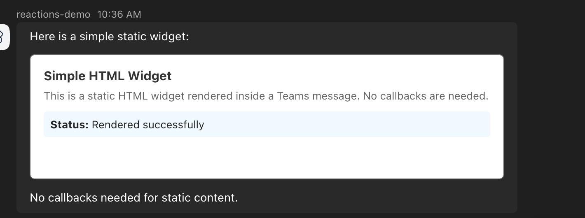
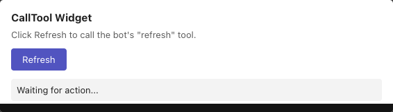
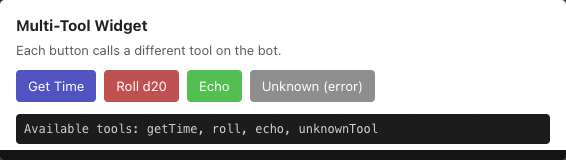
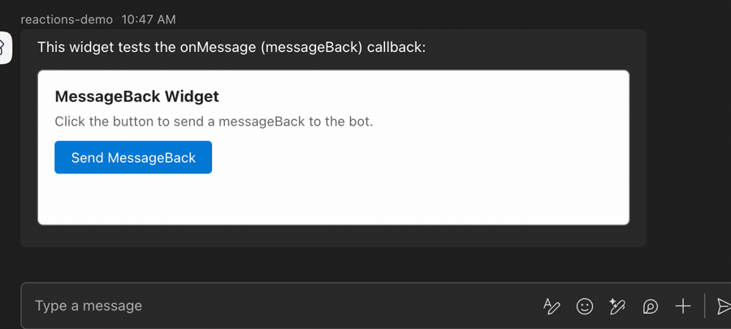
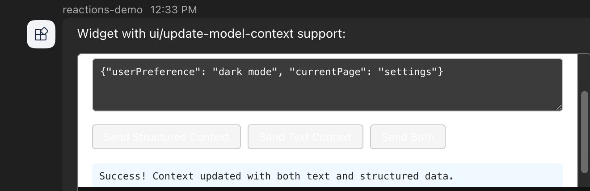
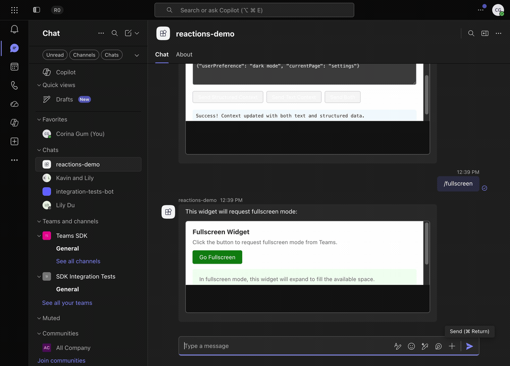
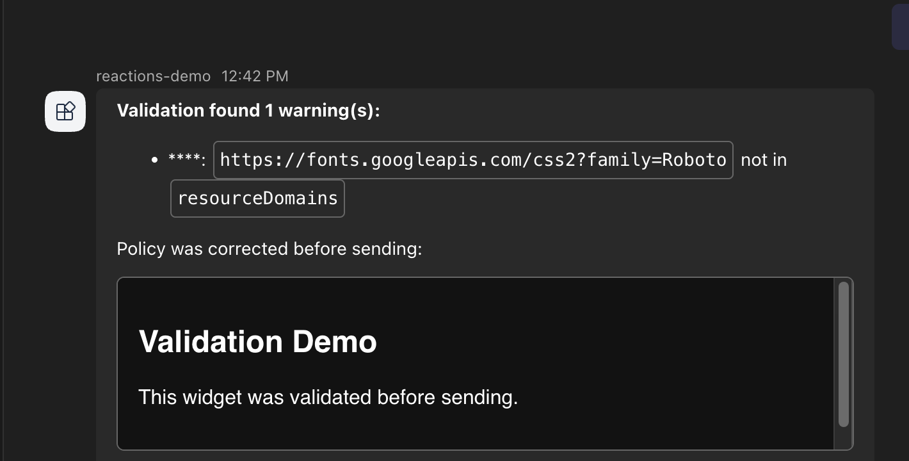
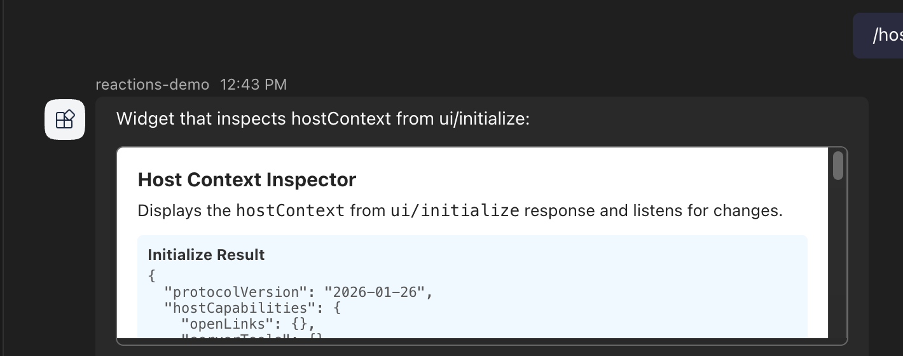

# HTML Widgets Example

This example bot demonstrates the HTML widget contract for Teams bots using the .NET Teams SDK.

## Demo

The bot renders several HTML widgets in Teams.
Each command below maps to a widget that exercises part of the widget contract.

### Static rendering (`/simple`)

A static widget renders directly from markdown with no callbacks.



### Tool call round-trip (`/calltool`)

Clicking the widget button calls a bot tool via an `htmlwidget/calltool` invoke, and the widget renders the returned result.



### Multi-tool dispatch (`/multi`)

The widget exposes several buttons that each dispatch to a different bot tool, showing per-tool arguments and results.



### messageBack round-trip (`/messageback`)

Clicking the widget button sends a `messageBack` to the bot, which echoes the received value.



### Update model context (`/context`)

The widget sends structured and text context to the model using `ui/update-model-context`.



### Fullscreen display mode (`/fullscreen`)

The widget requests fullscreen mode from Teams and expands to fill the available space.



### Payload validation (`/validate`)

The SDK validates the widget payload before sending and reports policy warnings.



### Host context inspection (`/hostcontext`)

The widget reads the `hostContext` from the `ui/initialize` response.



## Commands

| Command | Purpose | Widget callbacks |
|---------|---------|-----------------|
| `/simple` | Static widget rendering (no callbacks) | None |
| `/calltool` | Widget calling bot tools | `htmlwidget/calltool` invoke |
| `/messageback` | Widget sending messageBack | `onMessage` |
| `/fullscreen` | Widget requesting display mode change | `onRequestDisplayMode` (client-side) |
| `/multi` | Multiple tool dispatch | `htmlwidget/calltool` with different tool names |
| `/openlink` | Widget opening links via host | `ui/open-link` |
| `/context` | Widget updating model context | `ui/update-model-context` |
| `/hostcontext` | Inspecting host context from initialize | `ui/initialize` response |
| `/validate` | Security policy validation demo | None |
| `/help` | List available commands | None |

## Architecture

```
Bot sends message:
  textFormat: 'extendedmarkdown'
  text: "...\n```html-widget\n{JSON payload}\n```"

Teams client:
  McpWidgetRenderer loads widget HTML in sandboxed iframe
  MCP Apps protocol provides tools/call via postMessage

Widget calls tool:
  postMessage -> McpWidgetRenderer -> htmlwidget/calltool invoke -> Bot

Bot returns (invoke response body):
  {
    responseType: 'htmlwidget/calltoolresult',
    callToolResult: { content: [...], structuredContent: {...}, isError: false }
  }
```

The `HtmlWidgetHelpers.BuildHtmlWidgetMessage` helper builds the `extendedmarkdown`
message with the widget JSON wrapped in the required `html-widget` fenced code block.
It does not modify the widget HTML.

`HtmlWidgetPayload` also accepts an optional `McpUrl` (wire `mcpUrl`) and `CorrelationId` (wire `correlationId`), which are serialized only when set.
Teams combines `mcpUrl` with the owner id (`<ownerId>-<mcpUrl>`) as the input for deriving the widget hosting origin, so a widget produced by an MCP server must set `McpUrl` to that server's URL to get its own hosting scope, and returns the correlation vector to the bot.

## Handshake and sizing

The widget owns the MCP Apps handshake and its own sizing.
The SDK does not add any script to widget HTML.
Each widget in this sample includes the shared snippet in `Widgets.HostScript`, which:

1. Sends `ui/initialize` with `protocolVersion` `2026-01-26`, `appInfo`, and `appCapabilities`.
2. Waits for the response, then sends `ui/notifications/initialized`.
3. Reports height with `ui/notifications/size-changed` from one `ResizeObserver` on a single `#root` element, using the unrounded `getBoundingClientRect().height`, after the handshake and on every change.

Without a height reporter a widget stays at about 150px.
To keep the reported height accurate:

- Put all content inside the one root element and give it `display: flow-root`.
- Set `margin: 0` on `html` and `body`.
- Do not measure with `scrollHeight`, and do not size with `100vh` or `height: 100%`.

## Tool results and callTool arguments

`McpUiCallToolResult`, `HtmlWidgetCallToolResponse.FromText`, and `FromError` always serialize `content`, `structuredContent`, and `isError`, with defaults of `[]`, `{}`, and `false`, so the widget never receives `null` for them.

The Teams client adds `arguments.__msteams__ = { mcpUrl, correlationId }` to every `htmlwidget/calltool` request, replacing any value the widget supplied.
The SDK passes arguments through unmodified.
Handlers should ignore `__msteams__`, validate arguments as untrusted input, never throw, and not authorize from `activity.from`.

## Running

1. Copy credentials into the sample directory (see `bots/README.md` for setup).

2. Start a devtunnel and update the Azure Bot endpoint.

3. Run the bot:
   ```bash
   dotnet run
   ```

4. In Teams, message the bot with `/help` to see available commands.
